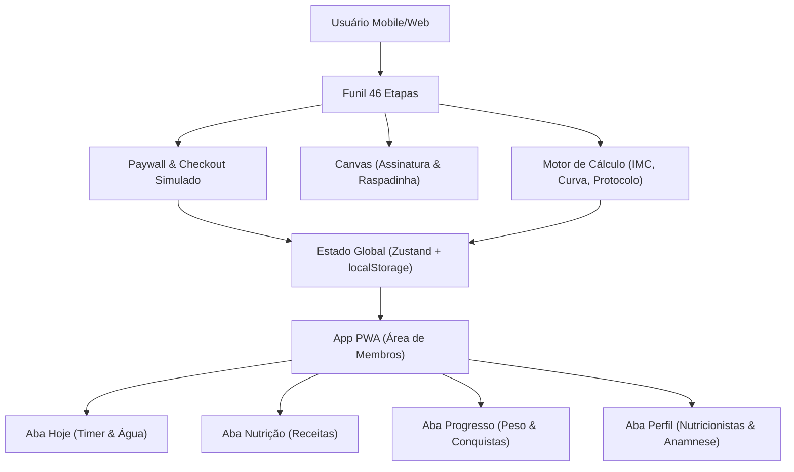

# Arquitetura — Best Me Fasting (PT-BR)

## Visão geral

Ecossistema web mobile-first de jejum intermitente em PT-BR composto por funil interativo de 46 etapas + paywall/checkout (Etapa 47) e área de membros PWA para acompanhamento diário (jejum, hidratação, receitas, biometria e orientação nutricional).

## Diagrama

## Recursos e serviços

| Recurso/Serviço | Tipo | Propósito | Status | Notas |
|---|---|---|---|---|
| SPA React + Vite | compute | Servir funil e app PWA | required | Build estático |
| `localStorage` | storage | Persistir progresso do quiz, assinatura e logs | required | Via Zustand `persist` |
| HTML5 Canvas API | other | Assinatura digital (Etapa 39) e raspadinha (Etapa 45) | required | Nativo do navegador |
| Service Worker / Manifest | other | Instalação PWA e uso offline básico | required | Configurado na Task 8 |
| Supabase / PostgreSQL | database | Persistência em nuvem de leads e logs | candidate | Fora do escopo v1 |

## Stack

| Parte | Tecnologias | Papel |
|---|---|---|
| Frontend | React 18+, TypeScript, Vite | Interface e roteamento de etapas/abas |
| Estilização | Tailwind CSS, `identidade/tokens.css` | Design system e tokens CSS |
| Animações | Framer Motion, `canvas-confetti` | Transições e celebrações |
| Estado | Zustand (`persist`) | Estado global do funil e do app |
| Testes | Vitest | Testes unitários do motor de cálculo |

## Decisões

- V1 100% client-side com `localStorage` para validar toda a jornada ponta a ponta sem dependência de backend.
- Design system centralizado em `identidade/tokens.css` e `identidade/components.css` conforme padrão `.claude`.
- Container do funil limitado a `480px` centralizado para manter foco mobile-first em qualquer tela.

## Requisitos não funcionais

- Responsividade mobile-first (touch events no Canvas e controles confortáveis).
- Persistência automática contra recarregamento de página durante as 46 etapas.
- Textos 100% em PT-BR com flexão automática de gênero (`mulher` / `homem`).

## Pontos em aberto

- Integração real com gateway PIX/Cartão e banco Supabase em versão futura.
