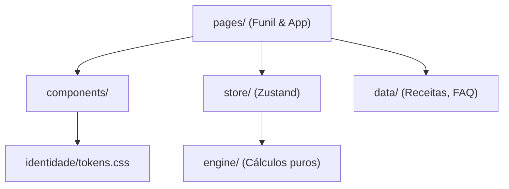

# Code Design — Best Me Fasting

## Princípios

- Código simples, modular e tipado em TypeScript.
- Motor de cálculos puros desacoplado da UI para facilitar testes unitários.
- Fonte única de tokens visuais em `identidade/tokens.css` integrada ao Tailwind.

## Estrutura

```text
best-me-fasting/
  docs/                  # arquitetura, code-design e tasks (.claude)
  identidade/            # tokens.css, components.css, tokens.json
  public/                # manifest.json, ícones PWA
  src/
    components/          # componentes reutilizáveis (Header, Cards, Canvas, Charts)
    engine/              # cálculos puros (IMC, peso ideal, projeção, protocolo, gênero)
    data/                # dados estáticos (receitas, depoimentos, FAQ nutricionistas)
    store/               # Zustand store (funnelStore, appStore)
    pages/
      funnel/            # etapas 0..47 do funil e checkout
      app/               # área de membros (4 abas)
    App.tsx              # alternância entre Funil e App PWA
  tests/                 # testes unitários (Vitest)
```

## Camadas e dependências



## Módulos principais

| Módulo | Camadas | Responsabilidade | Interface | Colabora com |
|---|---|---|---|---|
| `engine` | domínio | Flexão de gênero, IMC, peso ideal, curva e protocolo | funções puras TS | `store` |
| `store` | estado | Estado do funil (46 etapas) e logs do app | hooks Zustand | `engine`, `localStorage` |
| `funnel` | UI | Renderizar etapas 0–46 e checkout (47) | `<FunnelFlow />` | `store`, `components` |
| `app` | UI | Painel pós-checkout com 4 abas | `<MemberApp />` | `store`, `data` |

## Padrões e convenções

- Nomes de arquivos de componentes em `PascalCase.tsx`; utilitários e engine em `camelCase.ts`.
- Medidas armazenadas internamente em sistema métrico (`cm`, `kg`); conversão para imperial apenas na camada de exibição/input quando selecionado.
- Sem lógica de negócio dentro de componentes visuais complexos.

## Testes

- Testes unitários com Vitest em `tests/engine.test.ts` cobrindo IMC, faixa saudável, projeção de data, protocolo recomendado e meta de hidratação.
